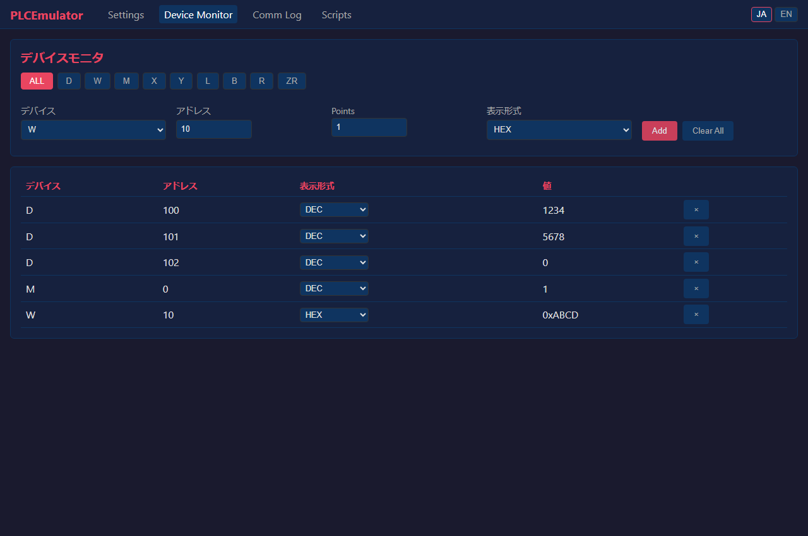

# v1.1.0 — PLC Emulator 正式リリースノート

**リリース日:** 2026年10月21日

---

## マイナーリリース (v1.1.0) — 32ビット整数表示対応 & 16進デバイス準拠の強化

PLCEmulator v1.1.0 では、Web デバイスモニタにおける 32ビット整数（DWORD / LONG）の表示・インライン編集機能の追加、三菱MELSEC仕様に準拠した16進デバイスアドレス指定の完全対応、設定の自動永続化、および README へのデモ動画・アニメーション追加によるドキュメント拡充を実施しました。

---

### ✨ 新機能 (New Features)

#### 1. デバイスモニタでの 32ビット整数表示・インライン編集 (DWORD & LONG) (#74)
- **32ビット表示フォーマットの追加**:
  - デバイスモニタの表示形式に `DWORD`（符号なし32ビット整数: 0 〜 4,294,967,295）および `LONG`（符号付き32ビット整数: -2,147,483,648 〜 2,147,483,647）を追加。
  - 連続する2つの16ビットワードレジスタ（例: `D100` と `D101`）をリトルエンディアン順で自動合成して32ビット値として表示。
- **WebSocket による複数ワードのリアルタイム自動購読**:
  - WebSocket 購読時に下位ワードと上位ワードの双方を自動監視し、いずれかのワードが更新された場合でもリアルタイムに合成値を更新表示。
- **32ビット値のインライン直接編集**:
  - `DWORD` / `LONG` 形式のセルをダブルクリックして32ビット数値を直接入力可能。
  - 入力された数値を下位・上位の16ビットワード値に自動分解し、REST API 経由でデバイスメモリに連続書き込み。

#### 2. デモアニメーション & プロモーション動画の追加 (#76)
- **ビジュアルな動作確認**:
  - README（日本語版 / 英語版）に操作デモ GIF アニメーションおよび高画質プロモーション解説動画を追加。
  - リアルタイムパケット解析、デバイス監視、YAML シナリオ実行の操作感を直感的に把握可能。

---

### ⚡ 改善点 (Improvements)

#### 1. 16進デバイスアドレス指定の完全準拠 (#72)
- **MELSEC 仕様への厳密な準拠**:
  - 16進デバイスであるリンクレジスタ（`W`）、入力（`X`）、出力（`Y`）、リンクリレー（`B`）、特殊リンクレジスタ（`SW`）、特殊リンクリレー（`SB`）について、16進数アドレス表記に完全対応。
  - `W10` は16進数 `0x10`（10進数 16）として扱われ、三菱製実機シーケンサとのアドレス表記の齟齬を解消。
- **DSL・数式エンジン・UI の統一対応**:
  - スクリプト YAML DSL（例: `W10`, `X1A`, `B20`）、数式評価エンジン（SafeEvaluator）、Web UI デバイスモニタのすべてで 16進表記を統一的にサポート。
- **厳格なアドレス検証**:
  - 10進デバイス（`D`, `M`, `L` 等）に対する誤った16進数表記をスクリプト構文解析段階で検出し、実行前に安全にエラーを通知。

#### 2. 設定の自動永続化 & アクティブポート表示 (#70)
- **設定変更の自動保存**:
  - Web UI の設定画面で変更した設定（PLC ポート番号、通信プロトコル、遅延シミュレーション等）を `saves/config.json` に自動保存し、次回起動時にも復元。
- **アクティブポートのリアルタイム表示**:
  - `/api/config` に `active_port` フィールドを追加し、設定画面で実際にリッスンしているポート番号をリアルタイム表示。
- **動的ポート変更テストの強化**:
  - 実行時のポート動的変更とソケット再バインドの動作を検証する結合テスト・E2Eテストを追加。

#### 3. マニュアル・DSL ドキュメント更新 (#74)
- ユーザーマニュアル（日英）および スクリプト DSL リファレンスを更新し、32ビット型、16進デバイス表記規則、PLC モデルごとの容量上限を詳細に記載。

---

### 🐛 不具合修正 (Bug Fixes)

- **設定画面ロード時のエラー修正 (#70)**: 設定画面を開いた際に発生していた `ReferenceError: params is not defined` を修正。
- **Git 管理のクリーン化**: プロジェクトルートに配置される一時 YAML スクリプトを `.gitignore` で除外。

---

### 🧪 テスト・品質検証

- **281 件の自動テストすべて合格**:
  - 3E/4E/1E/SLMP フレーム処理、ビット/ワード操作、32ビット表示パース、設定動的更新、AST 数式安全性など、全 281 件のテストを pytest で検証完了（合格率 100%）。

---

## ドキュメントリンク

- [ユーザーマニュアル（日本語）](docs/user_manual.ja.md)
- [User Manual (English)](docs/user_manual.md)
- [スクリプト DSL リファレンス](docs/script_dsl_reference.md)
- [リリースノート (v1.0.0)](RELEASE_NOTES_v1.0.0.ja.md)
- [リリースノート (v0.1.0)](RELEASE_NOTES_v0.1.0.ja.md)
